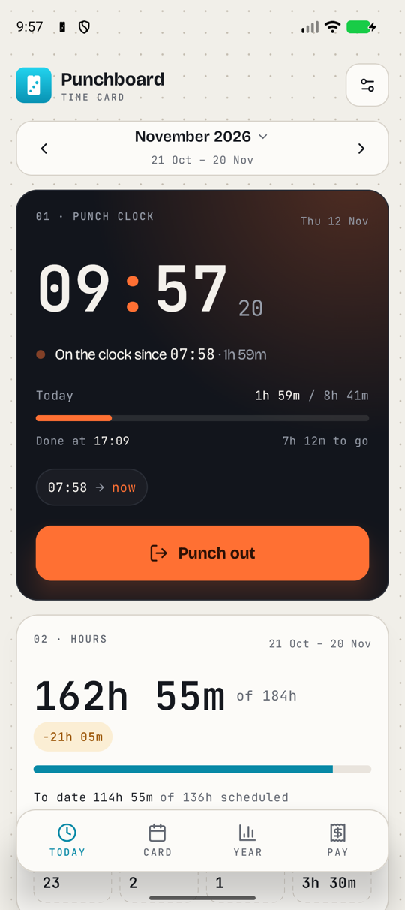
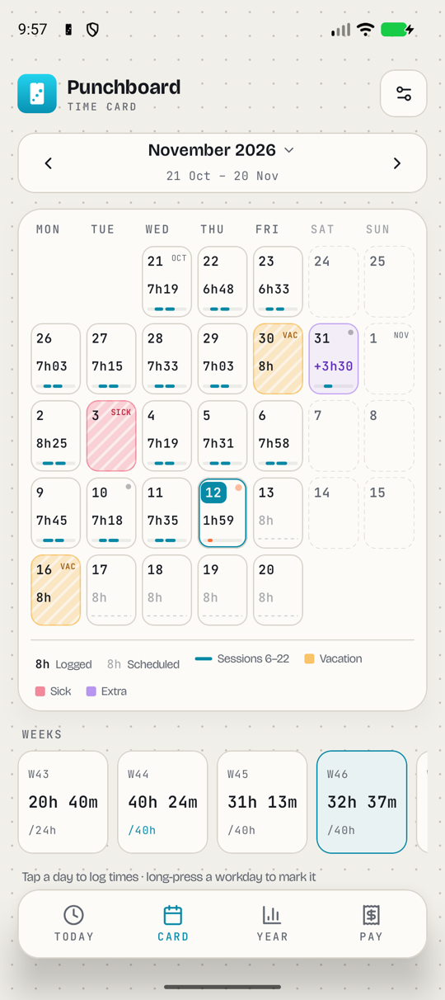
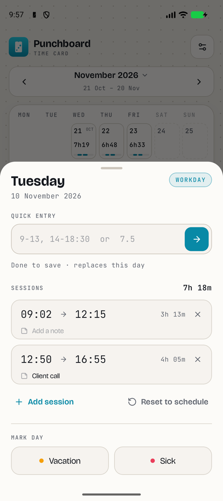
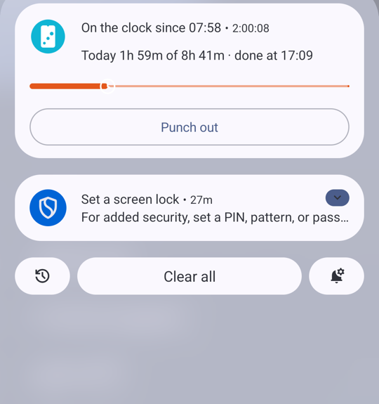
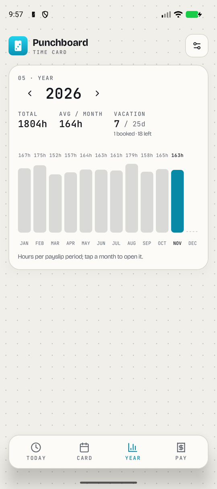
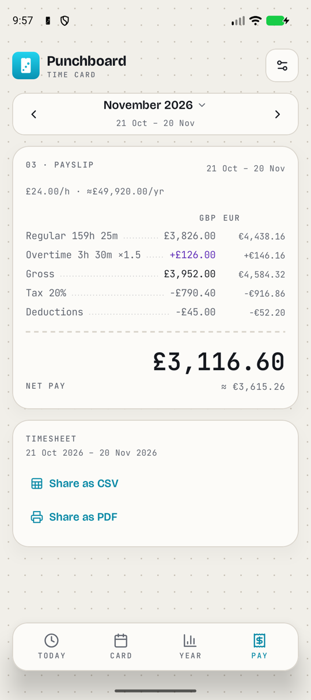

# Punchboard for Android

Track your daily work hours, estimate your pay and keep an eye on your
yearly workload — on your phone. The Android companion to
[Punchboard for desktop](https://github.com/QuackByte/punchboard), with the
same look, the same numbers, and the same data file.

**[⬇ Download the latest APK](https://github.com/QuackByte/Punchboard-Android/releases/latest/download/Punchboard.apk)**
· [All releases](https://github.com/QuackByte/Punchboard-Android/releases)
· [quackbyte.dev/punchboard](https://quackbyte.dev/punchboard/)

<p align="center">
  <picture>
    <source srcset="docs/screenshots/today-dark.png" media="(prefers-color-scheme: dark)" />
    
  </picture>
  &nbsp;
  <picture>
    <source srcset="docs/screenshots/card-dark.png" media="(prefers-color-scheme: dark)" />
    
  </picture>
  &nbsp;
  <picture>
    <source srcset="docs/screenshots/day-editor-dark.png" media="(prefers-color-scheme: dark)" />
    
  </picture>
</p>

## Features

- **Punch clock** — punch in and out with one tap. The running session is
  tracked live and saved as a real start and end time. See when you'll be
  done for the day (automatic break included) and the hours you've banked
  or owe from earlier weeks.
- **Live Update** — while you're on the clock, a chip in the status bar
  counts up today's time, and the lock screen shows your progress towards
  today's target with a **Punch out** button (Android 16+; older versions
  get the same card as a pinned notification).
- **Time card** — your payslip period as a calendar. Tap a day to log
  sessions with quick entry (`9-13, 14-18:30`, `8:45 to 17`, or a total like
  `7.5` / `7h 30m`) or by setting start and end times, with a note on each
  session. Long-press a workday to mark it vacation or sick, or reset it.
  Each week shows its total and your running balance.
- **Time rules** — an automatic unpaid break on long days, punch rounding,
  and an overtime rate for days off and, optionally, long workdays.
- **Balanced weeks** — today's target is what's left of your weekly hours,
  shared over the days still to come. On a salary, hours over or under carry
  into the next weeks, optionally from a start date, resetting each January
  or capped.
- **Pay** — by the hour or on a fixed salary, with tax, deductions and an
  optional second currency: gross, net and your effective hourly rate.
- **Year** — hours per payslip period across the year, plus vacation taken,
  booked and left against your allowance.
- **Timesheets** — share a period as a CSV or a one-page PDF.
- **Reminders** — a nudge to punch in on workdays, *Still on the clock?*
  once today's target is done, and *Forgot to punch out?* late in the day,
  each with a button to punch right from the notification.
- **Quick Settings tile and home-screen widget** — punch in and out from
  anywhere.
- **Undo**, **light and dark theme**, and no account, ads or tracking: your
  data stays in a file you own.

<p align="center">
  
  &nbsp;
  
  &nbsp;
  
</p>

## Install

1. On your phone, download
   **[Punchboard.apk](https://github.com/QuackByte/Punchboard-Android/releases/latest/download/Punchboard.apk)**
   from the latest release.
2. Open it. If Android asks, allow your browser or file manager to install
   apps, then tap **Install**.
3. Open Punchboard and either import your desktop data or start fresh.

Requires Android 8.0 or newer. Punchboard isn't on Google Play: new
versions are published on the
[Releases page](https://github.com/QuackByte/Punchboard-Android/releases),
and installing a newer APK over the old one keeps your data. Every release
is signed with the same key; its SHA-256 certificate fingerprint is
`E0:39:ED:8F:5D:51:2A:82:ED:84:9C:79:0A:8B:24:A6:4F:4B:A3:53:EE:D9:3E:F3:C5:2A:AD:B2:02:A3:60:07`.

## Using it with Punchboard for desktop

The desktop app keeps your time card in a plain `punchboard.json` file,
often in iCloud Drive, Google Drive or Dropbox. The phone can use that same
file:

1. In the desktop app, check where your data file lives (**Settings ›
   File**) and make sure it's in a folder your phone can reach, such as
   Google Drive or Dropbox.
2. On the phone, tap **Choose punchboard.json** on the welcome screen (or
   **Settings › Data & sync › Sync with a file…**) and pick that file.
3. Keep **Keep in sync with this file** on and import.

From then on the phone saves back to the file and picks up the desktop's
changes whenever you open it. Edits made on both sides are merged day by
day; if the phone and the desktop both change the same day, the one saved
last wins. Punchboard for desktop 1.15 and newer reloads the file when the
phone changes it; with an older desktop version, quit the desktop app while
you use the phone, or it may overwrite what the phone saved.

Prefer to keep them apart? Turn sync off and use **Export backup** /
**Restore backup** to move data by hand.

## Permissions

- **Notifications** — for reminders and the Live Update. You can turn each
  reminder off in Settings.
- **Run at startup** — so reminders survive a restart.
- **Promoted notifications** — lets the running punch show as a Live Update.
  You can turn Live Updates off in the system's notification settings.

Punchboard has no internet permission: it only reads and writes the files
you pick.

## Development

Requires JDK 17 and the Android SDK (compile SDK 37).

```bash
# Unit tests: the desktop's calculation tests, ported, plus file, sync, edit and reminder tests
./gradlew testDebugUnitTest

# Debug APK
./gradlew assembleDebug
```

Pull requests run the tests and a build in CI.

### Project structure

- `model/` — the data file, its key formats and every hour, pay and
  timesheet calculation, ported from the desktop's `types.ts`, `utils.ts`,
  `calculations.ts` and `timesheet.ts` together with their tests.
- `domain/` — `Tracker` reads a time card the way the desktop does (months
  not saved yet, today's balanced target, balances) and `TrackerEditor`
  makes the same edits (punches, quick entry, marks, settings that carry
  forward).
- `data/` — `DataFileCodec` (lossless JSON that keeps fields it doesn't
  know), `PunchboardStore` (the phone's copy, written atomically),
  `PunchboardRepository` (every edit goes through it, and it syncs) and
  `JsonMerge` (the three-way merge).
- `reminders/`, `punch/`, `widget/` — reminders, the Live Update, punch
  actions, the widget and the Quick Settings tile.
- `ui/` — Jetpack Compose screens in the desktop's design.

### Keeping the file format compatible

- Day keys are `YYYY-M-D` with a **zero-based** month and no padding
  (`2026-9-14` is 14 October 2026). Month keys are `YYYY-MM`, one-based.
- A running session is written as `"end": null`; the key must be present.
- Fields the app doesn't model are carried through every save, so a newer
  desktop's settings survive.

### Stack

Kotlin, Jetpack Compose, kotlinx.serialization and AndroidX. No other
dependencies.

## Releases

Releases are automated with
[release-please](https://github.com/googleapis/release-please), as on the
desktop: merging to `main` with conventional commits opens a release PR, and
merging that PR tags a release, builds a signed APK and attaches it as both
`Punchboard-<version>.apk` and `Punchboard.apk`.

Signing uses the repository secrets `KEYSTORE_BASE64`, `KEYSTORE_PASSWORD`,
`KEY_ALIAS` and `KEY_PASSWORD`. For a signed build locally, put a
`keystore.properties` (gitignored) next to this README with `storeFile`,
`storePassword`, `keyAlias` and `keyPassword`.

## License

[MIT](LICENSE). Fonts: Bricolage Grotesque and JetBrains Mono, under the
SIL Open Font License (see [`licenses/`](licenses)). Icons from
[Lucide](https://lucide.dev) (ISC).
